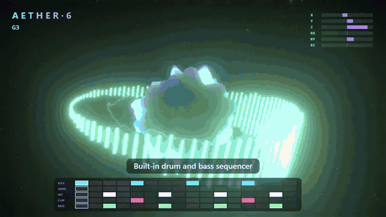
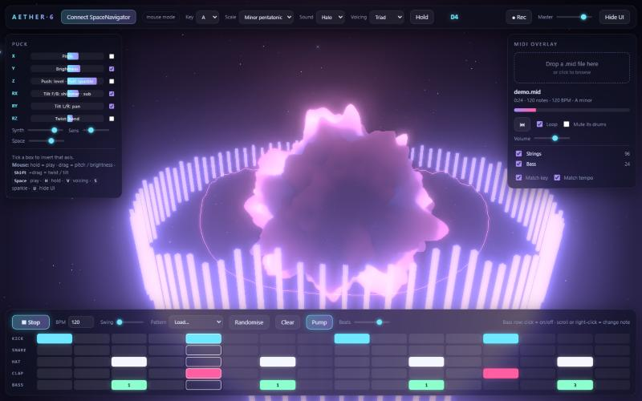
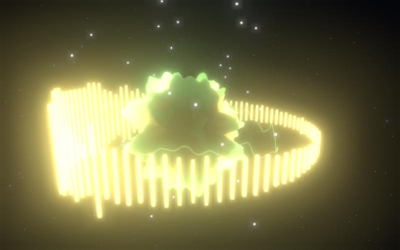

# AETHER·6

A browser-based ambient synth played with a 3Dconnexion SpaceNavigator. All six axes of the puck shape the sound, a three.js visualiser reacts to the audio, and you can jam over a built-in drum and bass sequencer or an imported MIDI file.

Everything lives in a single `index.html`. There is no build step and no dependencies to install.

[](docs/demo.mp4)

The clip above is a silent preview. [Watch the full 30-second demo with sound](docs/demo.mp4).



## Features

- **Six-axis instrument**: push, slide, tilt and twist the puck to control level, pitch, brightness, shimmer, pan and pitch bend.
- **Always in key**: pitch snaps to a chosen key and scale (pentatonic, minor, major, Dorian, Lydian and more).
- **Four sounds**: Halo, Glass, Reed and Void, with reverb and a tempo-synced ping-pong delay.
- **Drum and bass sequencer**: 16 steps of kick, snare, hat, clap and a bass line, with presets, swing, randomise and a sidechain "Pump" toggle.
- **MIDI overlay**: drop in a `.mid` file and play over it. The song's key and tempo are detected and the puck's scale is set to match.
- **Visualiser**: an audio-reactive orb, spectrum ring, waveform ring and particle bursts, with colour following the note you play.
- **Recording**: capture a jam to a `.webm` audio file.
- **Mouse fallback**: playable without a puck.



## Running it

You need Chrome or Edge, because the puck is read through WebHID, and an internet connection so three.js can load from a CDN.

Serve the folder locally:

```bash
python -m http.server 8642 --bind 127.0.0.1
```

Open `http://localhost:8642`, click **Start**, then **Connect SpaceNavigator** and pick the puck from the list.

## Controls

| Puck movement | What it does |
|---|---|
| Push down | Level (push to sing, release to fade) |
| Slide left / right | Pitch, snapped to the key and scale |
| Slide forward / back | Brightness (filter) |
| Pull up | Sparkle: random high plucked notes in key |
| Tilt forward / back | Forward adds an octave shimmer, back adds sub bass |
| Tilt left / right | Stereo pan |
| Twist | Pitch bend |
| Left button | Hold: freeze the note and level |
| Right button | Cycle the voicing (solo, fifth, triad, seventh, wide) |

Each axis has an invert tick box in the Puck panel.

### Mouse and keyboard

| Input | What it does |
|---|---|
| Click and hold the background | Play |
| Drag | Pitch and brightness |
| `Shift` + drag | Twist and tilt |
| `Space` | Play / stop the sequencer and MIDI |
| `H` | Hold |
| `V` | Next voicing |
| `S` (hold) | Sparkle |
| `U` | Hide or show the panels |

### Sequencer

Click a cell to toggle it. On the bass row, scroll or right-click a cell to change its note (1 to 8, as steps of the current scale).

### MIDI overlay

Drop a `.mid` file anywhere on the page, or click the drop zone. Tracks can be muted individually, and "Mute its drums" silences the file's drum channel so you can use the sequencer instead. Playback uses simple built-in sounds, not a full General MIDI sound set.

## Notes and limitations

- **Hardware status**: the device code follows the SpaceNavigator's documented HID reports, but has not yet been verified against a physical puck. If an axis feels backwards, use its invert box.
- **Device not listed**: Shift-click the Connect button to list every 3Dconnexion or Logitech HID device.
- **3Dconnexion driver**: the driver may also scroll or zoom the page while you play. Give the browser an empty profile in the driver, or pause the driver.
- **Background tabs**: browsers throttle hidden tabs, so timing gets choppy when the tab is not visible.
- **SMPTE-timed MIDI files** are not supported.

## Credits

The orb shader uses the 3D simplex noise function by Ian McEwan and Ashima Arts (MIT licence). Rendering is done with [three.js](https://threejs.org/).

## Licence

Released under the [MIT licence](LICENSE).
